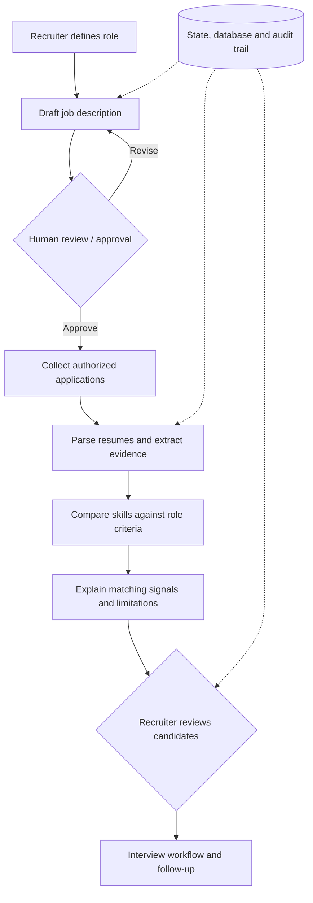

<!-- GitHub profile README | github.com/rajchakrawarti999 -->

<h1>Raj Chakrawarti</h1>

<h3>AI / ML Developer · Agentic AI Builder · Backend Engineering Learner</h3>

<strong>Building practical AI applications — and learning to engineer the reliable systems behind them.</strong>

  
  
  
  

<strong>Python · C++ · Machine Learning · RAG &amp; LLM Applications · LangGraph · System Design (learning)</strong>

📍 Jabalpur, India &nbsp; | &nbsp; 🎓 B.Tech ECE, Class of 2027 &nbsp; | &nbsp; 🎯 Exploring AI/ML and software engineering opportunities

---

## 👋 About Me

I'm an Electronics & Communication Engineering student at **Shri Ram Institute of Technology, Jabalpur**, moving deeper into **applied AI, software engineering, and intelligent backend systems**.

I enjoy understanding a problem end to end: **why it matters, how the data flows, what can fail, and how to make the solution useful**. My hands-on projects span multilingual document question answering, OCR, retrieval-augmented generation, computer-vision attendance, and machine-learning workflows.

Right now, I'm combining that AI foundation with practical work in **Agentic AI, LangGraph, FastAPI, backend development, database persistence, and System Design**. I'm deliberately learning the engineering *behind* the demo: APIs, state, storage, failure handling, evaluation, and maintainability.

> **What I'm working toward:** Building AI products that are explainable, testable, maintainable, and genuinely useful — not just interesting notebooks.

### At a glance

| Experience & practice | Snapshot |
|:--|:--|
| 🎓 Education | B.Tech in Electronics & Communication Engineering — expected **2027** |
| 🧪 Industry exposure | **Machine Learning Intern, CodeAlpha** (May–June 2026) |
| 🧠 Problem solving | **350+ LeetCode problems** and **700+ additional coding problems** practiced (resume-reported) |
| 📊 Applied ML | Classification, regression, EDA, feature engineering, and model evaluation |
| 🛠️ Engineering direction | Agentic AI workflows + backend fundamentals + System Design, through hands-on learning |

---

## 🚧 Flagship Project: AI Hire Agent

### An Agentic AI Recruitment Assistant — **actively under development**

Recruiters often spend time drafting job descriptions, reviewing resumes, comparing candidate skills, and coordinating the next step. **AI Hire Agent** is my ongoing attempt to design a single workflow that can assist with these repetitive tasks while keeping **people in control of hiring decisions**.

**Planned stack:** `Python` · `LangGraph` · `LangChain` · `LLM APIs` · `FastAPI` · `Streamlit` · `Database / Persistence`

**The system I'm designing:**

*This diagram describes the **target architecture**, not a claim that every component has been implemented.*

**Engineering goals for this build**

- **Stateful agent orchestration:** model the workflow as clear steps, transitions, and human approval points with LangGraph.
- **Evidence-based assistance:** surface relevant qualifications and reasons, rather than unexplained scores or automatic rejection.
- **Backend architecture:** separate API routes, business logic, agent workflows, and data-access layers.
- **Persistence and reliability:** learn durable conversations, database-backed state, retries, and safe recovery from failures.
- **Evaluation and observability:** design test cases for extraction quality, matching consistency, latency, and errors.
- **Privacy and fairness:** protect applicant information, limit access, and retain human responsibility for hiring decisions.

<b>🗺️ Development roadmap (open)</b>

| Phase | Focus | Status |
|:--|:--|:--|
| 01 | Define the recruitment problem, workflow, boundaries, and architecture | Design / iteration |
| 02 | Practice LangGraph state, nodes, routing, and checkpointing | Hands-on learning |
| 03 | Build recruiter-facing API and interface | Planned / developing |
| 04 | Add database persistence and role-based access | Planned |
| 05 | Connect resume processing, matching explanations, and approvals | Planned |
| 06 | Add tests, evaluation, tracing, and deployment | Planned |

A dedicated public repository will be linked when the implementation is ready to share.

---

## ⭐ Selected Projects

These are real, public repositories demonstrating different pieces of my engineering journey.

| Project | What I built / explored | Stack | Code |
|:--|:--|:--|:--|
| **PDF Chatbot with OCR** | Q&A over digital PDFs, scanned pages, and images; English/Hindi OCR, semantic retrieval, document-overview routing, and file/page citations. | Python, EasyOCR, OpenCV, ChromaDB, Sentence Transformers, Gemini, Streamlit | [Repository](https://github.com/rajchakrawarti999/pdf-chatbot-ocr) |
| **SnapClass — AI Attendance** | Teacher/student attendance workflow with enrollment links or codes, face recognition, and a database-backed application. | Python, Streamlit, Face Recognition, Supabase | [Repository](https://github.com/rajchakrawarti999/Snap_Class-Making_attendance_faster_using_AI) |
| **Advanced YouTube RAG Chatbot** | Transcript ingestion, vector search, query rewriting, hybrid retrieval, reranking, cited answers, and RAG evaluation experiments. | Python, LangChain, Pinecone, Sentence Transformers, Groq, Ragas | [Repository](https://github.com/rajchakrawarti999/Advanced-YouTube-RAG-Chatbot) |
| **Machine Learning Projects** | Iris classification, car-price prediction, sales prediction, and unemployment-trend analysis from my ML internship work. | Python, Pandas, scikit-learn, Jupyter | [Repository](https://github.com/rajchakrawarti999/Machine_learning_project) |
| **DSA Daily Practice** | Topic-wise algorithm implementations and problem-solving practice in C++. | C++, DSA | [Repository](https://github.com/rajchakrawarti999/DSA_Daily_Practice) |
| **Daily LeetCode Challenges** | A separate collection of problem solutions and algorithm patterns. | C++, DSA | [Repository](https://github.com/rajchakrawarti999/Daily_leetcode_challenges) |

### 🔎 Engineering decisions I care about

| Project | Design decision / lesson |
|:--|:--|
| **PDF Chatbot** | Use direct PDF text extraction when available; fall back to OCR for scanned content. Route broad document questions differently from specific retrieval questions. |
| **YouTube RAG** | Think beyond “embed and search”: query formulation, retrieval quality, reranking, citations, and evaluation change answer quality. |
| **SnapClass** | Treat a project as a full user workflow — registration, different roles, verification, and data storage — rather than just a model prediction. |
| **AI Hire Agent** | Design the workflow around approvals, explainability, failure cases, persistence, and human oversight from the beginning. *(In progress.)* |

---

## 🧰 Technical Toolkit

**Languages and foundations**

**Applied AI, ML and data**

**LLM applications and retrieval**

**Applications, tooling, and ongoing backend learning**

> **Skill transparency:** The badges represent technologies I have used, studied, or am currently learning; they are **not** a claim of production-level expertise in every tool. My public repositories show the work directly.

---

## 📚 What I'm Learning *Right Now*

My current goal is to become stronger at **building complete software systems**, not only training models or calling LLM APIs.

| Learning track | Current practical direction |
|:--|:--|
| **System Design** | Breaking features into components; understanding scale, bottlenecks, caching, queues, reliability, and trade-offs. |
| **Backend Engineering** | REST APIs with FastAPI, validation, error handling, service layers, authentication concepts, and database integration. |
| **Databases & Persistence** | SQL/DBMS fundamentals, data modeling, persistent chat history, thread state, and checkpoints. |
| **LangGraph & Agentic AI** | Nodes, edges, conditional routing, stateful execution, memory/checkpointing, tools, and human-in-the-loop flows. |
| **LLM Engineering** | RAG architecture, prompt design, grounded responses, model evaluation, latency/cost awareness, and observability. |
| **Software Quality** | Git workflows, debugging, reproducible environments, testing strategies, deployment basics, and maintainable code. |

**My learning loop:** Understand the concept → implement a small prototype → debug failures → explain the design → integrate it into a larger project.

---

## 💼 Experience

**Machine Learning Intern — CodeAlpha** | *May 2026 – June 2026*

- Built an **Iris Flower Classification** workflow with Random Forest, EDA, and hyperparameter tuning; achieved approximately **97% accuracy** in the project evaluation.
- Analyzed **unemployment trends across 21 Indian states** during the COVID-19 period and explored polynomial-regression forecasting.
- Created a **Car Price Prediction** regression workflow using gradient boosting and feature analysis.
- Explored **Sales Prediction** to compare advertising channels and their relationship with sales performance.

**What I gained:** experience moving from raw data through preprocessing, model selection, evaluation, and communicating results.

---

## 🏅 Certifications & Education

- **Oracle Cloud Infrastructure 2025 Certified Data Science Professional** — valid through August 2027 *(per resume)*.
- **Introduction to Machine Learning Concepts — Microsoft**, August 2025.
- **B.Tech, Electronics & Communication Engineering**, Shri Ram Institute of Technology, Jabalpur — **2023–2027 (expected)**.

---

## 📈 GitHub & Problem-Solving Activity

  
  

These are third-party GitHub activity widgets; availability and metrics can vary. For evidence of my work, browse the repositories linked above.

---

## 🤝 Connect

I'm interested in **AI/ML, applied GenAI, backend-oriented AI engineering**, and opportunities to learn from real engineering teams.

- **GitHub:** [github.com/rajchakrawarti999](https://github.com/rajchakrawarti999)
- **LinkedIn:** [Raj Chakrawarti](https://www.linkedin.com/in/raj-chakrawarti-069480307/)
- **LeetCode:** [rajchakrawarti](https://leetcode.com/u/rajchakrawarti/)
- **Email:** [rajchakrawarti787@gmail.com](mailto:rajchakrawarti787@gmail.com)

<strong>Learn deeply. Build deliberately. Explain clearly. Improve continuously.</strong>

Profile last refreshed: November 2026 · AI Hire Agent remains a work in progress.

